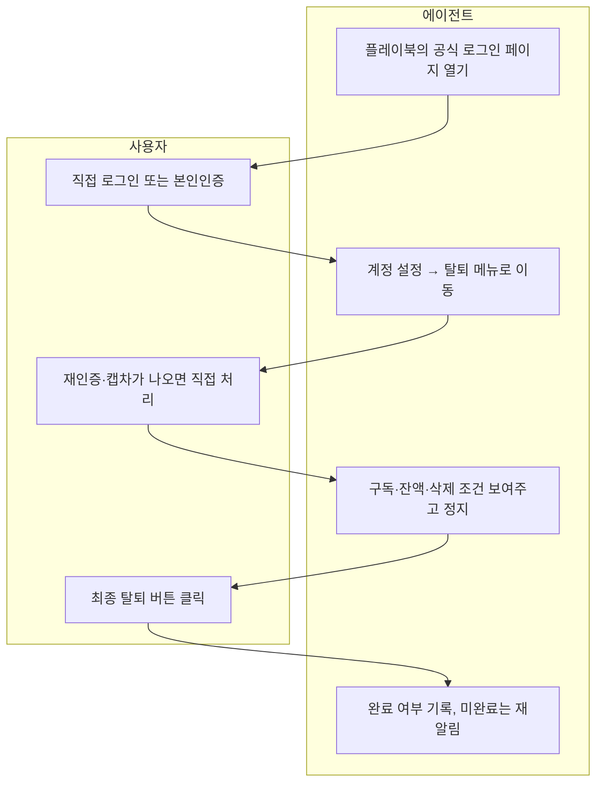

# PRD — 계정 정리 AI 에이전트

> **프로젝트:** 계정 정리 AI 에이전트
>
> **작성자:** 이정훈
>
> **버전:** v1.2
>
> **작성일:** 2026-11-12
>
> **상태:** 🟡 검토 중

오래된 메일함에서 잊힌 계정을 로컬 AI로 찾아내고, 사용자가 직접 인증하면 탈퇴 화면까지 안전하게 데려다주는 Mac/Windows 데스크톱 앱이다.

---

## 1. 문서 목적

이 문서는 MVP가 **무엇을** 해야 하는지 정한다. 모델 구조, 파싱 방식 같은 **어떻게**는 ADR과 시스템 아키텍처 문서(작성 미정)에서 다룬다. 아직 정하지 못한 사항은 [03. 논의사항](03_논의사항.md)에 모은다. 단, 브라우저 조작 방식은 제품 경험과 보안을 바로 좌우하므로 5장에서 원칙만 정한다.

---

## 2. 배경 및 문제 정의

### 2.1 문제 상황

사람들은 수년간 여러 서비스에 가입하고 잊는다. 쓰지 않는 계정은 유출 사고가 나면 그대로 공격 통로가 되지만, 어디에 가입했는지도 모르고 탈퇴 메뉴는 서비스마다 깊숙이 숨어 있다.

### 2.2 핵심 Pain Point

| # | 문제 | 영향 |
|---|---|---|
| P-1 | 가입한 서비스를 기억하지 못한다 | 유령 계정이 유출 위험으로 남는다 |
| P-2 | 어떤 방식(이메일, 소셜)으로 가입했는지 모른다 | 로그인에서 막혀 포기한다 |
| P-3 | 탈퇴 경로가 서비스마다 다르고 숨겨져 있다 | 구독 해지, 재인증 단계에서 이탈한다 |
| P-4 | 메일함을 외부 AI에 맡기기 불안하다 | 자동화 도구 자체를 쓰지 않는다 |

### 2.3 목표

> 사용자가 메일함을 기기 밖으로 내보내지 않고도, 잊힌 계정을 찾아 탈퇴 직전 화면까지 도달할 수 있게 한다.

---

## 3. 사용자

### Persona A — 유출 알림을 받은 일반 사용자

- **특징:** 한 이메일로 10년 넘게 여러 서비스에 가입했다.
- **목표:** 안 쓰는 계정을 한 번에 정리하고 싶다.
- **불편함:** 어디에 가입했는지, 탈퇴는 어디서 하는지 모른다.

### Persona B — 개인정보에 민감한 사용자

- **특징:** 메일과 비밀번호를 외부 서버에 맡기는 것을 꺼린다.
- **목표:** 자동화의 도움은 받되, 마지막 결정은 직접 하고 싶다.
- **불편함:** 기존 도구는 메일함 연동 권한이나 계정 정보를 요구한다.

---

## 4. 기능 요구사항

| 레벨 | 의미 |
|---|---|
| P0 | MVP 필수 — 없으면 데모가 성립 안 됨 |
| P1 | 1차 출시 목표 |
| P2 | 추후 개선 |

| ID | 기능 | 사용자가 할 수 있는 것 | 우선순위 |
|---|---|---|---|
| F-01 | 메일함 가져오기 | 메일 계정을 연결해 자동으로 불러오거나 MBOX/EML 파일을 넣는다. 어느 쪽이든 기기 안에서만 분석된다 (PoC는 Gmail·네이버 메일 기준) | P0 |
| F-02 | 메일 증거 분류 | 메일마다 가입·인증 / 보안·복구 / 거래·활동 / 약관·휴면 / 탈퇴 완료 / 광고·초대 중 하나로 분류된다 | P0 |
| F-03 | 계정 후보와 신뢰도 | 서비스별로 묶인 후보를 신뢰도, 근거 메일, 최초·마지막 메일 날짜와 함께 본다 | P0 |
| F-04 | 사용자 확인 | 후보마다 확정 / 제외 / 보류를 고른다 (이 라벨이 다음 학습 데이터가 된다) | P0 |
| F-05 | 로그인·복구 안내 | 가능한 로그인 방식과 비밀번호 재설정 경로를 본다 | P0 |
| F-06 | 탈퇴 화면 안내 | 사용자가 인증하면 에이전트가 탈퇴 화면까지 데려가고, 최종 버튼 전에 멈춘다 | P0 |
| F-07 | 탈퇴 전 조건 안내 | 구독, 잔액, 데이터 삭제 조건을 최종 탈퇴 전에 본다 | P0 |
| F-08 | 진행 기록과 재알림 | 서비스별 완료 여부가 기록되고, 미완료 계정은 일정 기간 뒤 다시 알림을 받는다 (저장된 로그인은 세션 보관 규칙에 따라 자동 삭제) | P1 |
| F-09 | 플레이북 확장 | 대표 3곳 외 서비스도 공개 도움말을 구조화해 지원한다 | P2 |

### 메일함 가져오기 방식 (F-01)

| 방식 | Gmail | 네이버 메일 |
|---|---|---|
| 계정 연결 (자동) | OAuth 로그인, 읽기 전용 권한. PoC는 Google 테스트 모드 | IMAP + 애플리케이션 비밀번호 (네이버는 메일용 OAuth를 제공하지 않음) |
| 파일 | 구글 테이크아웃 MBOX | EML (개인 계정 일괄 내보내기 가능 여부 확인 필요) |

- 파일 가져오기는 메일함 권한을 주기 싫은 사용자(Persona B)와 시연 비상 경로로 유지한다.
- 메일 **본문 전체**를 가져온다. 요약본(snippet)만 쓰면 분류 정확도가 떨어질 수 있다. 첨부파일은 받지 않는다.
- 불러오기는 **1회 실행**이다. 새 메일 자동 동기화는 하지 않는다 ([논의사항 D-07](03_논의사항.md)).
- OAuth 토큰과 애플리케이션 비밀번호는 불러오는 동안 메모리에서만 쓰고 **저장하지 않는다**.

서비스가 지원하는 로그인 방식과 사용자가 실제로 가입한 방식은 다르다. 메일에 명시된 경우만 확정하고, 나머지는 "가능한 로그인 방식"으로 표시한다.

---

## 5. 브라우저 조작 방식

**결정: 사용자가 쓰던 브라우저는 건드리지 않는다.** 앱 전용 프로필로 새 브라우저 창을 화면에 보이게 띄우고, 에이전트와 사용자가 번갈아 진행한다.

에이전트는 길 안내만 하고, 비밀번호 입력과 되돌릴 수 없는 클릭은 모두 사용자 쪽에 있다.

### 막혔을 때 (LLM 폴백)

기본은 플레이북에 적힌 경로를 스크립트로 따라간다. 화면이 바뀌어 다음 요소를 찾지 못하면, 현재 화면에서 링크·버튼 같은 조작 가능한 요소만 추려 LLM에 넘긴다. LLM은 그중 다음에 누를 요소 하나를 고르고, 실제 이동과 클릭은 코드가 아래 규칙(도메인 제한, 최종 버튼 금지)을 검사한 뒤 실행한다. 화면 전체나 입력값은 넘기지 않는다.

### 기존 브라우저를 쓰지 않는 이유

- **보안:** 기존 브라우저에 붙으면 메일, 은행 등 모든 로그인 세션이 AI 손에 들어간다. 유출 대응이 핵심인 서비스와 맞지 않는다.
- **기술:** 기존 Chrome에 붙으려면 원격 디버깅(CDP)이 필요한데, Chrome이 기본 프로필에서 이를 막는 추세다. 사용자에게 Chrome 재시작을 요구하게 된다.
- **안정성:** 사용자의 탭, 확장 프로그램, 동시 클릭이 에이전트 동작을 방해한다.
- **불편이 작다:** 탈퇴는 어차피 재인증을 요구하는 경우가 많아서, 로그인을 한 번 더 하는 비용이 크지 않다.

### 지켜야 할 규칙

| 규칙 | 내용 |
|---|---|
| 전용 프로필 | 로그인 상태는 앱 전용 폴더에만 저장해 재알림 때 이어서 쓴다 |
| 세션 보관 (임시 확정, [D-05](03_논의사항.md)) | 필요한 동안만 보관하고 끝나면 바로 지운다. ① 탈퇴 완료로 기록된 서비스는 그 도메인의 쿠키·저장소를 즉시 삭제 ② 미완료 서비스 세션은 재알림 1회 주기(예: 14일)까지만 두고 자동 삭제 ③ 설정 화면에 "저장된 로그인 모두 지우기" 버튼(전용 프로필 폴더 통째 삭제) |
| 설치된 Chrome 활용 | 실행파일만 빌려 써서 브라우저를 동봉하지 않는다 (프로필은 별도). PoC는 Chrome 설치를 전제로 한다 |
| 넘겨주기 조건 | 비밀번호 입력칸, 본인인증, 캡차, 2단계 인증, 결제 화면이 나오면 코드 규칙으로 에이전트를 멈춘다 |
| 도메인 제한 | 플레이북에 적힌 서비스 도메인 밖으로는 이동하지 않는다 |
| 최종 버튼 | 탈퇴 확정 버튼은 에이전트가 절대 누르지 않는다 |

웹페이지 안의 문구로 AI를 조종하는 프롬프트 인젝션은 도메인 제한과 최종 버튼 금지로 피해 범위를 막는다.

---

## 6. 비기능 요구사항

| # | 항목 | 요구사항 |
|---|---|---|
| NF-01 | 개인정보 | 메일 원문, 아이디, 비밀번호는 기기 밖으로 나가지 않는다. 메일 계정 연결 시 메일은 메일 서비스(Google·네이버)에서 사용자 기기로만 오고, 인증정보는 저장하지 않는다. 클라우드 LLM은 합성 데이터 생성, 공개 도움말 구조화, 그리고 막혔을 때 화면의 링크·버튼 요소 목록에서 다음 동작을 고르는 데에만 쓴다 (요소 문구 마스킹은 [논의사항 D-06](03_논의사항.md)) |
| NF-02 | 안전 | 인증과 최종 탈퇴는 항상 사용자가 직접 한다 |
| NF-03 | 설명 가능성 | 모든 후보에 근거 메일과 신뢰도를 보여 준다 |
| NF-04 | 플랫폼 | macOS와 Windows 데스크톱에서 동작한다 |
| NF-05 | 성능 | 메일 분류는 로컬 분류기로 돌아간다. 메일함 크기별 처리 시간 목표는 미정이다 |

---

## 7. 범위 외

아래는 v1에서 만들지 않는다.

- 완전 자동 탈퇴 (최종 버튼을 AI가 누르는 것)
- 언어모델 학습·파인튜닝 (사전학습 임베딩은 고정하고 로컬 분류기만 학습)
- 새 메일 자동 동기화 (불러오기는 1회, [D-07](03_논의사항.md))
- Gmail OAuth 앱 정식 공개 (Google 보안 심사 필요, PoC는 테스트 모드)
- Gmail·네이버 외 메일 서비스의 계정 연결과 내보내기 안내
- Chrome 외 브라우저 (Edge, 동봉 Chromium 등)
- 사용자가 쓰던 브라우저의 기존 로그인 세션 재사용
- 모바일 앱
- 대표 3곳 외 서비스의 탈퇴 자동 안내

---

## 8. 성공 지표

| 지표 | 목표 |
|---|---|
| 계정 탐지 재현율 | 정답 계정의 80% 이상 |
| 설명 가능성 | 모든 후보에 근거 메일과 신뢰도 표시 |
| 개인정보 | 메일 원문·인증정보 외부 전송 0건 |
| 브라우저 시연 | 대표 3곳 중 2곳 이상 탈퇴 화면 도달 |
| 안전 | 사용자 승인 없는 최종 탈퇴 0건 |

---

## 9. 용어

| 용어 | 뜻 |
|---|---|
| 계정 후보 | 메일 증거로 묶인 "가입했을 가능성이 있는 서비스" 하나 |
| 증거 유형 | 메일 한 통이 계정 존재를 얼마나 증명하는지의 분류 (F-02의 6가지) |
| 로컬 분류기 | 기기 안에서 도는 고정 임베딩 + 로지스틱 회귀. 언어모델(SLM)이 아니다 |
| 규칙 엔진 | 도메인 정규화와 키워드 규칙. 확실한 경우는 AI 없이 처리 |
| 클라우드 LLM | 외부 API 언어모델. NF-01에 적힌 용도로만 쓴다 |
| 브라우저 에이전트 | 전용 프로필 Chrome 창을 조작해 탈퇴 화면까지 이동하는 부분 |
| 플레이북 | 서비스별 로그인·복구·탈퇴 경로를 적은 JSON |
| 넘겨주기 | 비밀번호, 본인인증, 캡차 등에서 에이전트가 멈추고 사용자에게 조작을 넘기는 것 |
| LLM 폴백 | 플레이북 스크립트가 막혔을 때만 LLM이 다음 요소를 고르는 것 |

---

_다음 문서: [02. ADR — 기술 스택 선정](02_ADR_기술스택.md) · [03. 논의사항](03_논의사항.md)_
