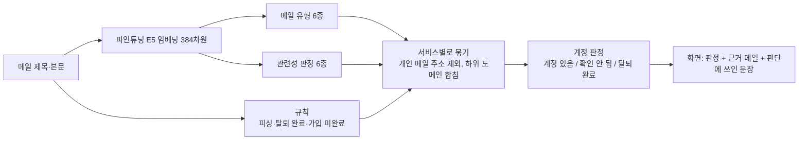

# 메일 증거 분류기 — 모델 카드와 학습 근거

작성일: 2026-11-17, 갱신: 2026-11-20 (v3, 정답 계정 평가, 실제 서비스 탈퇴, E5 파인튜닝). 실제 메일 원문·검토 메모·메일 ID·학습 가중치는 비공개 로컬 파일로 보관한다. 이 문서에는 집계 수치와 방법만 적는다. v2까지의 기계 판독용 집계는 [model_training_evidence.json](model_training_evidence.json)에 있다.

## 0. 한눈에 보기

> 공개 다국어 언어 인코더(E5)를 우리 메일 자료로 파인튜닝하고, 그 위에 로컬에서 학습한 작은 분류기 두 개와 사람이 작성한 규칙을 얹은 메일 분석기다. 메일은 PC 밖으로 나가지 않는다. 사용자 본인이 표시한 정답 계정 79개 기준으로 계정 탐지 재현율 97~99%, 잘못 잡은 서비스 0개다.

| 항목 | 현재 시연 모델 |
|---|---|
| 임베딩 | `intfloat/multilingual-e5-small` (MIT 라이선스)을 메일 966통으로 **파인튜닝** (5.6) |
| 메일 유형 분류 (6종) | 파인튜닝 인코더 위에 다시 학습 |
| 관련성 판정 (6종) | 파인튜닝 인코더 위에 다시 학습, 임계값 0.4 |
| 규칙 | 피싱, 탈퇴 완료, 가입 미완료, 개인 메일 주소, 서비스 묶기 |
| 계정 판정 | 기본 "계정 있음", 반대 근거가 있을 때만 내림 |
| 실행 | CPU, 메일 124통 약 30초 |

인코더(1.18억 파라미터)는 파인튜닝했고 생성형 대규모 언어모델은 앱에 넣지 않았다. 비교용으로 Qwen2.5-1.5B도 파인튜닝해 봤다(5.6). PRD의 "고정 임베딩 + 로지스틱 회귀"에서 인코더 고정만 풀었고, 크기·속도는 그대로다.

## 1. 구조

처리 순서:

1. 피싱으로 보이는 메일은 근거에서 뺀다 (규칙).
2. 관련성 판정이 "의심·업무"라고 하면 근거에서 뺀다. "광고"면 광고 근거로 바꾼다. 명시적 규칙이 결정한 메일은 건드리지 않는다.
3. 남은 메일을 서비스별로 묶는다. `gmail.com`·`naver.com` 같은 개인 메일 주소는 서비스가 아니다. `txn.dropbox.com`과 `dropbox.com`은 한 서비스다.
4. 서비스마다 계정 판정을 한다 (4장).

## 2. 자체 학습과 공개 모델의 경계

| 부분 | 출처 | 학습 여부 |
|---|---|---|
| E5 인코더 | 공개 모델 ([모델 카드](https://huggingface.co/intfloat/multilingual-e5-small)) | 전체 파인튜닝 (GPU 약 40초) |
| 메일 유형 분류기 | 직접 학습 | 로지스틱 회귀 계수 6×384 |
| 관련성 판정기 | 직접 학습 | 로지스틱 회귀 계수 6×384 |
| 피싱·탈퇴 완료·가입 미완료 규칙 | 사람이 작성 | 학습 아님 |
| 계정 판정 점수 | 사람이 정한 근거 세기 | 학습 아님, 측정된 확률 아님 |

가중치는 실행 가능한 pickle이 아니라 JSON으로 저장한다. 모델 폴더 구성은 `manifest.json`, `weights.json`, `gate.json`(선택), `e5/`(선택, 상대 경로)다. 모델 폴더는 저장소에 없다.

## 3. 데이터와 라벨

| 자료 | 양 | 라벨 방법 | 쓰임 |
|---|---:|---|---|
| 기존 Gmail 자료 | 144통 | AI 초안, 일부 사용자 검토 | v1·v3 학습 |
| 회사 메일 백업에서 추출 | 419통 | Claude가 마스킹된 본문을 읽고 판정 | v3 학습 |
| 회사 메일 `(광고)` 표기 메일 | 73통 | 제목 표기로 자동 | v3 학습 |
| Gmail (커넥터로 수집) | 108통 | Claude가 제목·미리보기를 읽고 판정 | v3 학습 |
| 합성 메일 | 140통 | 유형을 정해 작성 | v3 학습 |
| **정답 계정 목록** | **88개 서비스** | **사용자 본인이 표시** | **평가 전용** |

- v3 학습 자료는 합계 884통이다. 회사 메일 백업 9,444통 전체를 학습한 것이 아니다.
- **라벨링 단계에서는 클라우드 AI(Claude)가 마스킹된 메일 본문을 읽었다.** 이메일·링크·긴 숫자는 가렸지만 완전한 익명화는 아니다. 앱 실행 중에는 메일이 외부로 나가지 않는다.
- 정답 계정 목록은 학습에 쓰지 않았다.

## 4. 계정 판정 방식

개인 메일함에서는 메일을 계속 보내는 서비스가 거의 다 회원 가입한 곳이었다 (5장). 한국 서비스는 광고·개인정보 이용내역을 회원에게 보낸다. 그래서 **남은 서비스는 기본 "계정 있음"이고, 반대 근거가 있을 때만 내린다.**

| 판정 | 조건 |
|---|---|
| 계정 있음 | 기본값. 가입·로그인·결제 근거가 있으면 정렬 순위가 올라감 |
| 탈퇴 완료 | 마지막 결정적 메일이 명시적 탈퇴 완료 문구 |
| 확인 안 됨 | 가입 인증 요청·가입 거절만 있고 다른 메일이 없음 |
| (후보 아님) | 피싱, 개인 메일 주소, 업무 메일, 결제대행사 |

- 비밀번호 재설정 요청은 계정이 있다는 뜻이므로 "가입 미완료"로 보지 않는다.
- 삭제 예정·휴면 안내는 계정이 아직 있으므로 "계정 있음"이다.
- 내부 점수는 정렬용이다. 화면에는 퍼센트를 보이지 않는다.

## 5. 평가

### 5.1 정답 계정 평가 (가장 중요한 수치)

사용자 Gmail 표본 160통에 나온 서비스 89개에 사용자가 "가입함 / 안 함 / 모름"을 표시했다 (가입함 79, 안 함 2, 모름 2, 미응답 1). "모름"은 계산에서 뺐다. "계정 있음"으로 판정한 서비스를 맞힌 것으로 센다.

| 방식 | 재현율 | 잘못 잡음 (안 함 2개 중) |
|---|---:|---:|
| 가입 근거를 증명하는 이전 방식 (v1 / v3 / 시연 모델) | 70% / 68% / 65% | 1 |
| 단순 기준: 메일 온 서비스를 전부 계정으로 | 99% (78/79) | 2 |
| **현재 방식 (v1 / 시연 모델)** | **99% (78/79) / 97% (77/79)** | **0** |

- 이전 방식은 단순 기준보다 못했다. 놓친 계정 대부분은 광고·약관 메일만 있던 서비스였다. 이 결과로 판정 방식을 4장처럼 바꿨다.
- 시연 모델이 놓친 2개 중 1개는 "탈퇴 완료"로 표시된 서비스로, 가입은 했지만 이미 없어진 계정이라 판단은 맞다. 나머지 1개는 사용자 회사 도메인이 업무 메일로 걸러진 경우다.
- 표본은 가입·로그인·결제·광고 단어 검색으로 모은 메일이라 가입한 서비스 쪽으로 치우쳐 있다. 메일함 전체의 재현율이 아니다. "안 함"이 2개뿐이라 정밀도는 의미 있게 말할 수 없다.

### 5.2 관련성 판정 교차검증 (v3)

학습에 쓰지 않은 실제 메일(기존·회사·Gmail)로 5겹 교차검증. 같은 발신처·같은 문구는 학습과 평가에 겹치지 않게 묶었다. 라벨은 대부분 Claude 판정이다.

| 임계값 | 피싱·업무 걸러냄 | 이용 메일을 잘못 걸러냄 | 이용 메일을 광고로 낮춤 | 광고를 광고로 판정 |
|---|---:|---:|---:|---:|
| 0.5 | 60% | 0% | 1% | 50% |
| **0.4 (현재)** | **74%** | **2%** | **3%** | **63%** |

### 5.3 피싱 규칙

| 자료 | 피싱 검출 | 정상 메일 오검출 |
|---|---:|---:|
| 회사 메일 | 73 / 161 | 0 / 259 |
| 합성 메일 | 9 / 10 | 0 / 142 |
| 기존 학습 자료 | 10 / 18 | 0 / 128 |
| Gmail | — | 0 / 109 |

규칙을 만들면서 이 자료를 보고 조정했으므로 처음 보는 메일에서는 검출률이 낮을 수 있다. 정상 메일을 잃지 않는 쪽으로 보수적으로 잡았다.

### 5.4 탈퇴 완료 규칙

| 자료 | 이전 규칙 | 현재 규칙 |
|---|---:|---:|
| 합성 탈퇴 완료 12통 (한국어 6, 영어 6) | 3 | 12 |
| 합성 비완료 140통 (삭제 예정·구독 해지 등) | 오검출 0 | 오검출 0 |
| 실제 탈퇴 완료 메일 2통 | 1 | 2 |

### 5.5 개발 과정에서 확인한 것

| 시도 | 결과 |
|---|---|
| 임베딩 교체 검토 | E5와 문자 TF-IDF가 같은 성능 → 임베딩 크기는 병목이 아님 |
| 합성 메일 추가 | 이용 흔적/보류 2분류 76.6% → 82.4% |
| 실제 광고 20통 추가 | 광고 오분류 51% → 25% |
| 제목 키워드로 붙인 약한 라벨 | 역효과 (피싱을 이용 흔적으로 학습) |
| 본문을 읽고 판정한 라벨 | 처음 보는 메일 일치율 83% → 88% |

자료 양보다 라벨 품질이 성능을 갈랐다.

### 5.6 파인튜닝 비교

같은 학습 메일 731통, 같은 평가 메일 146통(실제 메일, 발신처 묶음이 학습과 겹치지 않음)으로 관련성 6종을 비교했다. 메일 유형 6종은 앱 `train`과 같은 분할(학습 66, 평가 23).

| 방식 | 크기 | 관련성 정확도 | 매크로 F1 | 계정 근거 여부 | 유형 정확도 | 메일당 시간 |
|---|---|---:|---:|---:|---:|---|
| E5 고정 + 로지스틱 회귀 (이전) | 470MB | 76% | 0.68 | 81% | 74% | CPU 0.06초 |
| Qwen2.5-1.5B 그대로 | 3GB | 34% | 0.23 | 58% | — | GPU 0.06초 |
| Qwen2.5-1.5B LoRA 파인튜닝 | 3GB + 71MB | 88% | 0.86 | 94% | — | GPU 0.09초, CPU 7.1초 |
| **E5 파인튜닝 + 로지스틱 회귀 (현재)** | **470MB** | **88%** | **0.87** | **93%** | **91%** | **CPU 0.07초** |

- E5 파인튜닝: 관련성·유형 두 과제의 분류층을 함께 붙여 인코더 전체를 학습(4회 반복, 학습률 3e-5, 배치 8, 균형 가중치). 학습 뒤 분류층은 버리고, 앱과 같은 JSON 로지스틱 회귀 가중치를 새 임베딩 위에 다시 맞춘다.
- Qwen LoRA: 보기 글자(A~F) 다음 토큰 확률로 분류, r=16, 3회 반복, GPU 약 14분.
- 작은 인코더를 파인튜닝한 것이 1.5B 언어모델 파인튜닝과 같은 정확도를 냈고, CPU 속도는 100배 빠르다. 그래서 앱에는 E5 파인튜닝을 넣었다.
- 정답 계정 재현율(5.1)은 이전·현재 모두 97% (77/79), 잘못 잡음 0. 계정 판정이 "기본 계정 있음"이라 메일 단위 정확도 향상이 서비스 단위 결과를 바꾸지 않았다. 향상은 근거 메일 분류(광고·피싱·업무 거르기)의 품질에서 나타난다.
- 평가 메일이 146통(인증 요청 8, 삭제 예정 4)이고 한 번의 분할이라 오차가 크다. 라벨 대부분이 AI 판정이다.

## 6. 실제 서비스로 끝까지 해 본 결과 (Dropbox)

테스트 계정으로 메일 분석 → 탈퇴 안내 → 에이전트가 계정 설정 화면으로 이동 → 사용자 직접 삭제까지 진행했다.

- Google 로그인으로 만든 계정은 삭제 전에 **Dropbox 비밀번호를 새로 설정**해야 했다. 플레이북의 탈퇴 전 확인 사항에 추가했다.
- 메일상으로는 있던 다른 테스트 계정이 실제로는 없었다. **메일은 과거 기록이고, 현재 계정 상태는 로그인해야 안다.**
- 탈퇴 과정에서 온 로그인·비밀번호 메일은 탈퇴 완료로 잘못 잡히지 않았다.
- 에이전트는 삭제 화면 입구에서 멈췄고, 영구 삭제는 사용자가 직접 눌렀다. 최종 버튼을 대신 누르지 않는 설계대로다.
- **Dropbox는 계정을 삭제해도 완료 메일을 보내지 않았다** (2026-11-20, 삭제 후 Gmail 휴지통까지 확인). 가입·로그인·비밀번호 메일은 보낸다. 따라서 완료 메일 확인은 서비스에 따라 불가능하며 보조 근거로만 쓴다. 최종 완료는 사용자의 "탈퇴를 끝냈어요" 확인으로 기록한다.

## 7. 한계

- 정답 평가는 사용자 1명, 표본 88개 서비스다.
- 학습 라벨 대부분이 AI 판정이다. 사람이 확인한 평가는 5.1의 정답 계정 목록뿐이다.
- 회사 메일함에서는 거래처·기관이 "계정 있음"으로 많이 나온다. 개인 메일함을 대상으로 한 설계다.
- 한 서비스에 주소가 다른 계정이 여러 개 있어도 하나로 묶인다.
- 메일만으로는 이미 지워진 계정, 현재 활성 여부, 실제 가입 방식(이메일·소셜)을 확정할 수 없다.
- 탈퇴 완료 확인은 보조 근거다. 최종 완료는 사용자가 "탈퇴를 끝냈어요"로 확정한다.

## 8. 재현

- v1 학습: [`classifier/model.py`](../app/src/account_cleaner/classifier/model.py) `train`
- v2 실험: [`classifier/experiment.py`](../app/src/account_cleaner/classifier/experiment.py)
- v3 관련성 판정 학습과 정답 계정 평가 스크립트는 개인 메일 경로를 읽어 저장소 밖 비공개 폴더에 있다. 같은 E5 임베딩에 `LogisticRegression(class_weight='balanced', C=4.0, max_iter=3000)`을 학습하고, 발신처·문구 그룹으로 나눈 5겹 교차검증으로 임계값을 정했다.
- E5 파인튜닝·LLM 비교 스크립트도 비공개 자료를 읽어 저장소 밖에 있다. 방법은 5.6에 적었다. 파인튜닝한 모델 폴더의 `manifest.json`에는 `encoder_frozen: false`, `fine_tuned: true`가 기록된다.
- AI 포함 빌드: 모델 폴더를 `app/src/account_cleaner/classifier/bundled/`에 두고 빌드하면 실행파일 안의 모델을 쓴다 ([CLASSIFIER.md](../app/CLASSIFIER.md)).

## 9. 발표에서 쓰는 표현

- 맞는 표현: "공개 언어 인코더(E5)를 우리 메일 자료로 파인튜닝하고 분류기와 규칙을 얹은 메일 분석기", "1.5B 언어모델 파인튜닝과 같은 정확도를 100배 빠르게", "사용자 본인 Gmail의 정답 계정 기준 재현율 97~99%", "앱 실행 중 메일 외부 전송 0건"
- 피할 표현: "AI가 계정을 정확히 찾는다(일반화된 정확도)", "대규모 언어모델을 앱에 넣었다", "정답 계정 재현율이 파인튜닝으로 올랐다", "학습 과정에서도 외부 AI를 쓰지 않았다"
