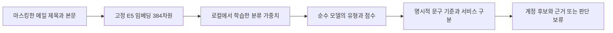

# 메일 증거 분류기 — 모델 카드와 학습 근거

작성일: 2026-11-17. 실제 데이터·원문·검토 메모·메일 ID·학습 가중치는 비공개 로컬 파일로 보관한다. 공개하는 것은 학습 코드, 집계 지표, 파라미터, 데이터와 결과의 해시다. 기계 판독용 집계는 [model_training_evidence.json](model_training_evidence.json)에 있다.

## 1. 무엇을 개발하고 학습했는가

> 공개 다국어 임베딩 모델을 고정된 특징 추출기로 사용하고, 메일 제목·본문에 대한 분류기를 로컬에서 학습했다. 가입·사용·탈퇴 관련 근거를 서비스별로 묶어 데스크톱 앱에 전달하며, 명시적인 완료 표현은 보조 기준으로 확인한다.

대규모 언어모델을 처음부터 만들거나 파인튜닝한 것이 아니다. Codex의 내부 사고 과정을 복사한 것도 아니다. AI가 작성한 초안 라벨로 분류기를 학습한 부분과 사람이 검토한 부분을 구분한다. 모델의 자유로운 설명 생성이 아닌 분류 예측이며, 화면의 판단 이유 일부는 확인 가능한 문구 기준으로 만든다.



## 2. 기본 모델과 자체 학습의 경계

| 항목 | 내용 |
|---|---|
| 기본 모델 | `intfloat/multilingual-e5-small` |
| 출처 | [공식 모델 카드](https://huggingface.co/intfloat/multilingual-e5-small) |
| 로컬 스냅샷 | `614241f622f53c4eeff9890bdc4f31cfecc418b3` |
| 특징 차원 | 384 |
| 텍스트 처리 | `query: ` 접두어, 최대 512토큰, 정규화 임베딩 |
| 기본 모델 가중치 | 고정. 이번 학습에서 업데이트하지 않음 |
| 자체 학습 부분 | class-balanced 로지스틱 회귀 분류 계수와 절편 |
| 실행 | CPU, 배치 8통, 로컬 캐시만 사용 |

E5의 구조·입력 방식은 공식 모델 카드에 근거하며, 수신 메일 분류 성능은 그 모델 카드의 검색 벤치마크와 별개다. 최초 공개 모델 다운로드와, 실제 메일을 이용한 학습·추론을 구분한다. 실제 메일 학습·추론에는 외부 AI API를 호출하지 않았다.

## 3. 데이터와 라벨

| 구분 | v1 — 현재 시연 | v2 — 실험용 |
|---|---:|---:|
| 사용 가능한 자료 | Gmail 89통 | Gmail·토브넷 합계 146통 |
| 학습 분할 | 66통 | 113통 |
| 개발 점검 분할 | 23통 | 33통 |
| 출력 | 메일 유형 6종 | 관련성 4종·유형 6종·단계 6종 |
| 라벨 출처 | AI 초안 | 사용자 검토 기록 20통, 기존 AI 초안 73통, 추가 AI 초안 53통 |

수집량과 학습량은 다르다. Gmail에서 확보한 147통 전체나 토브넷 백업의 9,444개 파일 전체를 학습한 것이 아니다. v1은 기존 96통 중 언어·본문 품질 등을 이유로 7통을 제외한 89통을 사용했다. v2는 선정한 자료 중 위 146통을 사용했다. 토브넷에 따로 보관한 평가 후보 자료는 이번 학습에 사용하지 않았다.

사람이 검토했다고 무조건 정확한 정답으로 간주하지 않는다. v2에서 본문 의미나 선택지 정의와 충돌한 유형 4개·단계 3개는 해당 출력의 학습에서 보류했다. 사용자 답을 조용히 수정하거나 대체하지 않았다. 사용자 검토 자료 중 유형 라벨 16개, 단계 라벨 17개가 유효 대상으로 남았다. 관련성 라벨은 유형과 본문 해석에서 파생했으며 사용자가 관련성 범주를 따로 선택한 정답은 아니다.

마스킹은 이메일·링크·일부 번호·인증값 등을 줄이는 전처리이며 완전한 익명화를 뜻하지 않는다. 실제 데이터와 모델은 저장소에 포함하지 않는다.

## 4. 실제 학습 방법

v1 학습 코드는 [`app/src/account_cleaner/classifier/model.py`](../app/src/account_cleaner/classifier/model.py)에 있다. 고정 E5 임베딩을 만든 후 `LogisticRegression(class_weight='balanced', max_iter=2000, random_state=42)`의 `fit`으로 6개 유형의 분류 계수를 학습했다. 같은 분할에서 문자 TF-IDF + 로지스틱 회귀 기준선도 학습했다.

v2 재현 코드는 [`app/src/account_cleaner/classifier/experiment.py`](../app/src/account_cleaner/classifier/experiment.py)에 있다.

1. 제목과 본문만 임베딩한다. 정답, 검토 메모, 파일명, 서비스명 초안을 입력하지 않는다.
2. 서비스/공유 발신 그룹과 유사 본문을 묶는다. v2 자료 준비에서 문자 TF-IDF 코사인 유사도 0.86 이상을 같은 그룹으로 합쳤다. 완전한 템플릿 중복 탐지라고 보장하지 않는다.
3. `GroupShuffleSplit(test_size=0.25, random_state=42)`의 첫 유효 분할을 선택한다. 유효성은 학습·점검에 유형과 관련성 범주가 존재하는지만 검사하며, 점수를 보고 좋은 분할을 고르지 않는다.
4. 같은 그룹이 양쪽에 없는지 검사한다. 라벨이 보류된 필드는 해당 분류기의 학습·점검에서 제외한다.
5. 관련성·유형·단계별 로지스틱 회귀를 각각 `fit`한다. `C=4.0`, `class_weight='balanced'`, `max_iter=2000`, `random_state=42`이며 사용자 검토 자료의 입력 가중치는 2, AI 초안은 1이다.
6. 학습하지 않은 개발 분할의 예측·지표를 저장한다. 계수와 절편은 실행 가능한 pickle 대신 JSON으로 저장한다.

학습은 표현과 범주 사이의 분류 경계를 적합하는 과정이다. 명시적인 가입 환영·인증 요청·삭제 완료 문구의 보조 기준은 사람이 작성한 코드이며 학습된 가중치가 아니다.

## 5. 측정 결과와 해석

### v1: 같은 개발 분할에서의 기준선 비교

| 방법 | 일치율 | Macro F1 |
|---|---:|---:|
| 문자 TF-IDF + 로지스틱 회귀 | 14/23, 60.9% | 0.547 |
| 고정 E5 + 로지스틱 회귀 | 17/23, 73.9% | 0.611 |

AI 초안 라벨에 대한 개발 점검이다. 특히 삭제 유형은 점검 1개를 놓쳤으므로 탈퇴 완료 탐지 성능을 입증하지 못했다.

### v2: 순수 학습 모델과 보조 기준 적용 후 구분

| 출력 | 순수 모델 일치율 | Macro F1 | 보조 기준 적용 후 일치 |
|---|---:|---:|---:|
| 메일 유형 | 20/25, 80.0% | 0.639 | 23/25, 92.0% |
| 계정 관련성 | 28/33, 84.8% | 0.717 | 28/33 |
| 단계 | 18/26, 69.2% | 0.489 | 18/26 |

라벨이 있는 필드만 평가하므로 분모가 다르다. 대부분 AI 초안이고 이미 개발 과정에서 확인한 자료도 있어 독립적인 실제 정확도가 아니다. ‘92%’는 규칙을 포함한 개발용 유형 일치율이지 순수 AI 모델 성능이나 최종 평가 정확도가 아니다. v1과 v2 표는 분할·자료가 달라 직접적인 성능 향상 비교가 아니다.

v2의 같은 개발 표본에 기존 v1을 적용하면 유형 일치율은 84%였다. v1이 일부 자료를 이미 학습에서 봤을 가능성이 있어 공정한 비교는 아니지만, v2의 순수 유형 모델이 개선됐다고 주장할 근거도 없다. 따라서 시연 모델을 자동 교체하지 않았다.

## 6. 재현 증거

2026-11-17에 정리한 공용 학습 코드로 v2의 동일 입력을 **다시 임베딩하고 다시 학습**했다. 기존 결과와 관련성·유형·단계 3개 분류기의 JSON 가중치가 정확히 일치했다. 최대 계수 차이는 세 분류기 모두 0.0이다. 결과를 읽기만 한 검사가 아니라 로컬 E5 인코딩과 `fit`을 다시 실행한 결과다.

집계 JSON에는 입력 파일 SHA-256, 학습 코드 SHA-256, 가중치 SHA-256, 학습 파라미터, Python과 라이브러리 버전, 각 출력 계수의 크기와 재현 일치 여부를 기록했다. 이 값들은 실험 파일의 버전을 식별하는 자료이며 개인 메일을 공개하지 않는다. 재현 시 환경은 Python 3.12.16, sentence-transformers 6.3.0, scikit-learn 1.9.1, torch 2.15.0, transformers 5.22.2였다. 초기 실험 manifest의 상속된 패키지 정보보다 실제 재현 실행에서 수집한 환경 기록을 기준으로 삼는다.

```powershell
# app 폴더에서, 사용자가 관리하는 비공개·마스킹·라벨 자료와 로컬 E5 스냅샷으로 실행
uv run --group ml python -m account_cleaner.classifier.experiment --input 'C:\local-only\training_rows.jsonl' --model-path 'C:\local-only\e5-snapshot' --output 'C:\local-only\new-experiment'
```

입력 필드는 `id`, `subject`, `body_text`, `group`, `type_label`, `relevance_label`, `stage_label`, `provenance`, `weight`다. 보류 라벨은 `null`이다. 원본 라벨 작성과 그룹 묶음 과정은 데이터 준비 단계이므로 별도로 기록·검토해야 한다. 추후 데이터가 달라지면 같은 지표가 보장되지 않는다.

## 7. 시연으로 입증하는 것과 남은 검증

모아북 합성 시연은 파일 파싱 → 로컬 분류기 실행 → 후보 표시 → 브라우저 안내 → 새 완료 메일 확인 → 앱 알림이라는 **연결 흐름**을 입증한다. 명시적 완료 문구는 [`completion.py`](../app/src/account_cleaner/classifier/completion.py)의 보수적인 규칙으로 확인한다. 실제 서비스 탈퇴 성공이나 낯선 메일의 분류 정확도를 증명하는 시험은 아니다.

다음에는 새 시연 계정의 실제 가입·탈퇴 메일로 실행을 검증하고, 별도의 새 평가 자료를 모델·규칙 튜닝에 쓰지 않은 채 검토해야 한다. 발신자 진위 검증, 일반 업무·의심 메일 오탐, 긴 본문 잘림, 희소한 삭제 완료 사례, 단계 선택지의 중첩은 남은 한계다.

발표에서는 **‘공개 임베딩 모델을 활용한 로컬 메일 증거 분류기 학습 및 탈퇴 지원 앱 통합’**이라고 설명하는 것이 현재 구현에 맞다.
