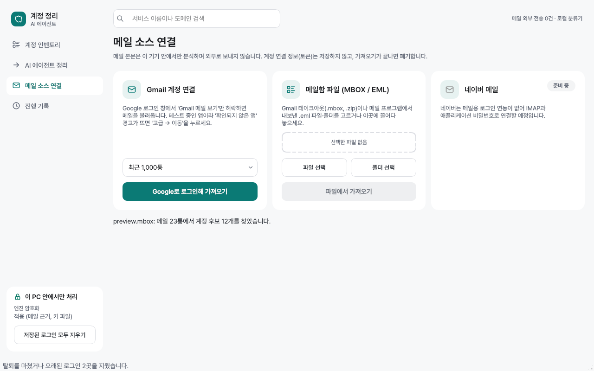
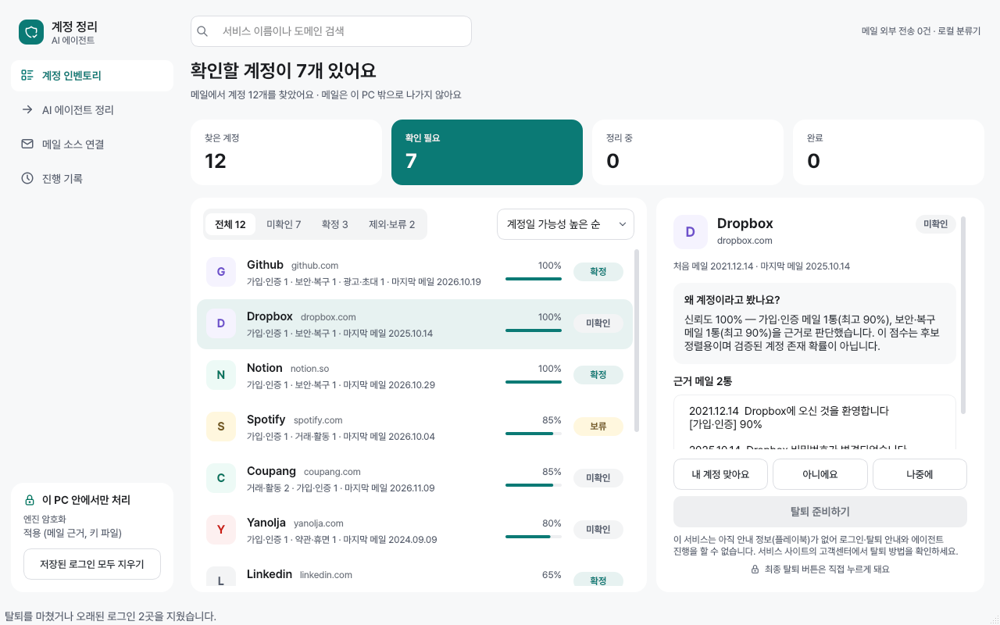
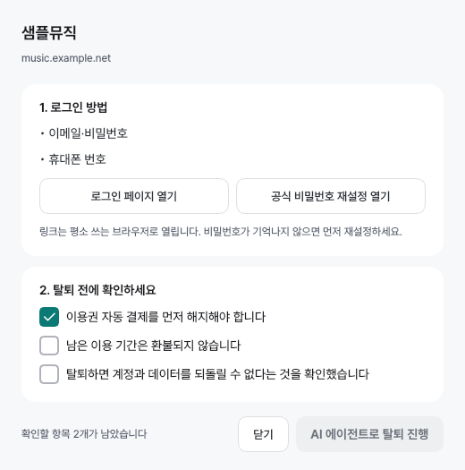
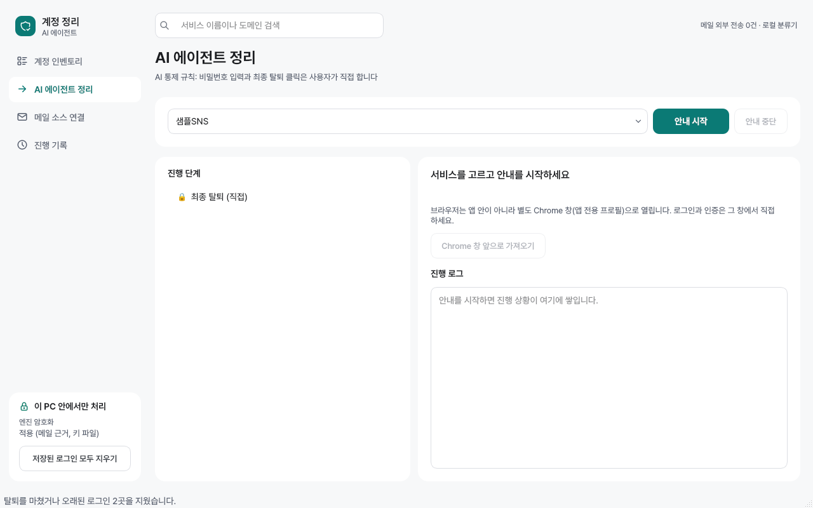
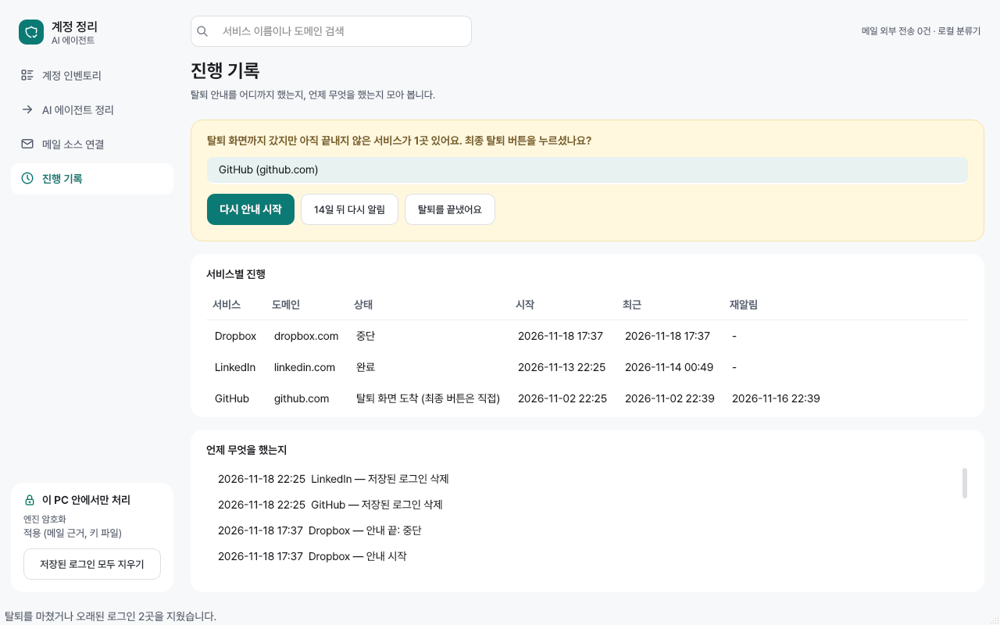

# 화면별 사용 가이드

> 처음 쓰는 사람용 짧은 안내서다. 화면 모양은 아직 다듬는 중이라 그림과 조금 다를 수 있다.

## 한 줄 요약

**메일을 불러오면 → 내가 가입한 서비스 목록이 나오고 → 정리할 곳을 골라 → AI가 탈퇴 화면까지 길을 안내한다.**
마지막 "탈퇴" 버튼은 언제나 **내가 직접** 누른다.

```
① 메일 소스 연결  →  ② 계정 인벤토리  →  ③ AI 에이전트 정리  →  ④ 진행 기록
   메일 불러오기        내 계정 확인하기       탈퇴 화면까지 안내       끝냈는지 챙기기
```

---

## ① 메일 소스 연결 — 메일 불러오기



**여기서 할 수 있는 것**
- **Gmail 계정 연결**: 개수(최근 1,000통 등)를 고르고 `Google로 로그인해 가져오기`를 누른다.
  - "확인되지 않은 앱" 경고가 뜨면 `고급 → 이동`을 누른다 (테스트 중인 앱이라서 뜨는 경고다).
- **메일함 파일**: `.mbox`, `.eml`, `.zip` 파일이나 폴더를 고르거나 카드 위로 끌어다 놓고 `파일에서 가져오기`를 누른다.
- 오래 걸리면 `가져오기 취소`를 누른다.

**알아 두면 좋은 것**
- 메일은 이 PC 안에서만 분석한다. 밖으로 보내지 않는다.
- Google 로그인 정보는 저장하지 않는다. 그래서 다시 불러올 때마다 로그인한다.
- 다 끝나면 "메일 N통에서 계정 후보 N개를 찾았습니다"가 뜨고 ②번 화면으로 넘어간다.

---

## ② 계정 인벤토리 — 내 계정 확인하기



> 그림은 연습용 가짜 데이터로 찍었다. 그래서 `탈퇴 준비하기` 버튼이 꺼져 보인다.

**맨 위 문장**: 지금 할 일을 알려 준다 (예: "확인할 계정이 7개 있어요").

**숫자 카드**: 찾은 계정 / 확인 필요(청록) / 정리 중 / 완료 개수.

**여기서 할 수 있는 것**
- **찾기**: 맨 위 검색창에 서비스 이름이나 도메인을 친다.
- **나눠 보기**: `전체 / 미확인 / 확정 / 제외·보류` 탭, 오른쪽 위 정렬(계정일 가능성 높은 순, 최근 메일 순).
- 목록 한 줄에는 서비스 이름·도메인, 근거 요약, 계정일 가능성(%), 상태 배지가 보인다. 글이 잘리면 마우스를 올려 전체를 본다.
- **목록에서 하나를 누르면** 오른쪽에 자세한 내용이 나온다.
  - "왜 계정이라고 봤나요?" — 어떤 메일 몇 통이 근거인지
  - 근거 메일 목록. 하나 누르면 본문 앞부분이 보인다.
  - `내 계정 맞아요` / `아니에요` / `나중에` 로 표시한다.
  - `탈퇴 준비하기`: 안내 창이 하나 뜬다.

    

    1. 로그인 방법과 비밀번호 재설정 링크를 본다 (평소 쓰는 브라우저로 열림).
    2. 탈퇴 전에 확인할 것(유료 플랜, 저장된 파일 등)을 모두 체크한다.
    3. `AI 에이전트로 탈퇴 진행`을 누르면 ③번 화면으로 넘어간다.
  - `탈퇴를 끝냈어요`: 안내를 받은 뒤 최종 탈퇴를 마쳤으면 누른다.

**알아 두면 좋은 것**
- 계정일 가능성(%)은 정렬하는 기준일 뿐이다. 꼭 근거 메일을 보고 판단한다.
- 앱을 껐다 켜도 목록과 내가 표시한 상태는 그대로 남는다.
- `탈퇴 준비하기` 버튼이 꺼져 있으면 아직 안내 정보(플레이북)가 없는 서비스다. 지금은 GitHub, Dropbox, LinkedIn만 된다.

---

## ③ AI 에이전트 정리 — 탈퇴 화면까지 안내받기



**여기서 할 수 있는 것**
- 서비스를 고르고 `안내 시작`을 누른다. ②번 화면에서 시작했다면 자동으로 시작된다.
- **별도 Chrome 창**이 열리고 AI가 설정 메뉴를 따라 탈퇴 화면으로 이동한다.
- 왼쪽 **진행 단계**에서 지금 어디까지 왔는지 본다.
- 로그인이나 인증이 나오면 AI가 멈추고 "로그인해 주세요"라고 알려 준다.
  → Chrome 창에서 **직접** 로그인한 뒤 `직접 처리했어요, 계속`을 누른다.
- Chrome 창이 안 보이면 `Chrome 창 앞으로 가져오기`를 누른다.
- 그만두려면 `안내 중단`을 누르거나 Chrome 창을 닫는다.
- 처음이라면 서비스 목록의 `안전 데모 (로컬)`로 연습해 본다. 진짜 사이트에는 접속하지 않는다.

**꼭 기억할 것 🔒**
- AI는 **비밀번호를 입력하지 않고, 최종 탈퇴 버튼도 누르지 않는다.**
- 탈퇴 화면에 도착하면 AI는 멈춘다. 내용을 확인하고 최종 버튼은 내가 누른다.
- 다 끝냈으면 ②번 화면에서 `탈퇴를 끝냈어요`를 누른다.

---

## ④ 진행 기록 — 끝냈는지 챙기기



**여기서 볼 수 있는 것**
- **서비스별 진행**: 어디까지 했는지(안내 중, 탈퇴 화면 도착, 완료), 다시 알려 줄 날짜
- **언제 무엇을 했는지**: "2026-11-18 09:30 GitHub — 안내 시작" 같은 기록

**다시 알려 주기 (14일 뒤)**
- 탈퇴 화면까지 갔는데 `탈퇴를 끝냈어요`를 안 누른 서비스는 **14일 뒤** 앱을 켤 때 알림이 뜬다.
- 알림이 뜨면 이 화면 위쪽에서 고른다.
  - `다시 안내 시작`: 다시 탈퇴 화면까지 안내받는다.
  - `14일 뒤 다시 알림`: 나중에 한다.
  - `탈퇴를 끝냈어요`: 이미 끝냈다.

---

## 왼쪽 아래 버튼

| 항목 | 뜻 |
|---|---|
| "이 PC 안에서만 처리" 카드의 엔진 암호화: `적용 (메일 근거)` | 근거 메일(보낸 사람·제목·본문 앞부분)을 암호화해서 저장하고 있다는 표시 |
| `저장된 로그인 모두 지우기` | AI 안내용 Chrome에 남은 로그인을 전부 지운다. 평소 쓰는 Chrome은 그대로다 |

로그인은 원래 자동으로 정리된다. 탈퇴를 끝낸 서비스는 바로, 못 끝낸 서비스는 14일 뒤에 지운다.

---

## 자주 묻는 것

- **Q. 탈퇴를 AI가 다 해 주나요?** 아니요. 탈퇴 화면까지 길만 안내한다. 최종 버튼은 내가 누른다.
- **Q. 내 메일이 어디로 가나요?** 이 PC 밖으로 나가지 않는다. 분석이 끝나면 본문은 버리고, 근거 메일의 앞부분만 암호화해서 남긴다.
- **Q. 목록이 이상해요 / 처음부터 다시 하고 싶어요.** ①번 화면에서 메일을 다시 불러오면 목록이 새로 바뀐다. 내가 표시한 상태는 남는다.
- **Q. 받은 실행파일에서는 분석 결과가 좀 엉성해요.** 지금 배포본은 간이 분석기를 쓴다. 자세한 내용은 [실행 방식별 기능](../app/RUN_MODES.md)에 있다.

---

_이전 문서: [04. 브라우저 에이전트](04_브라우저에이전트.md)_
