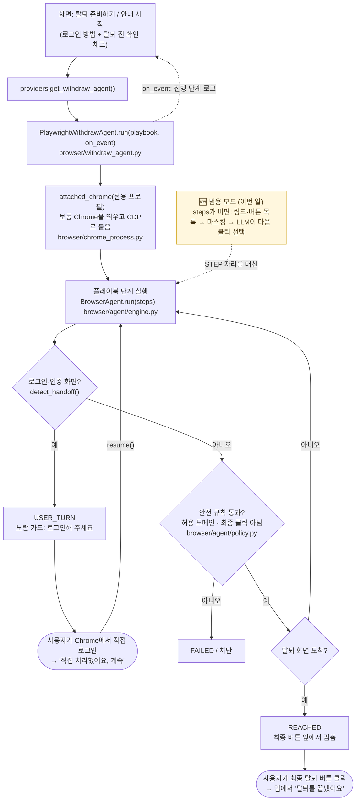
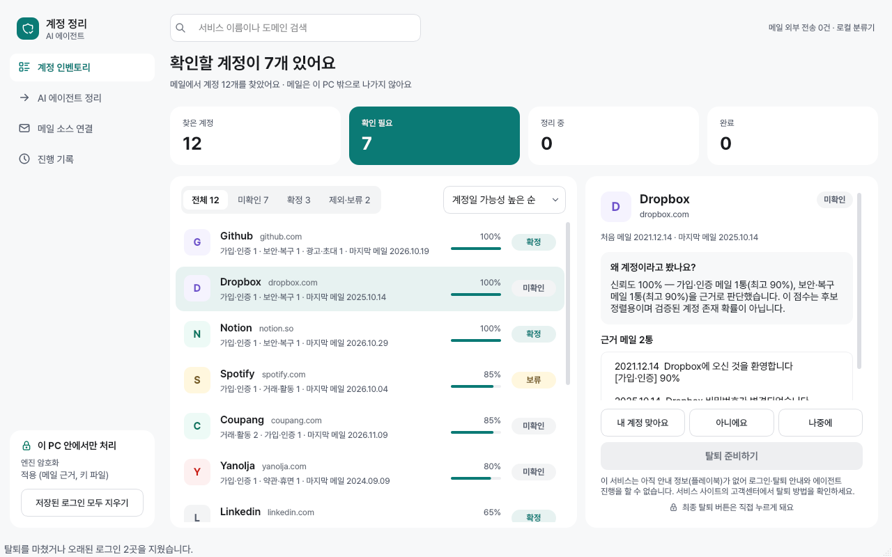
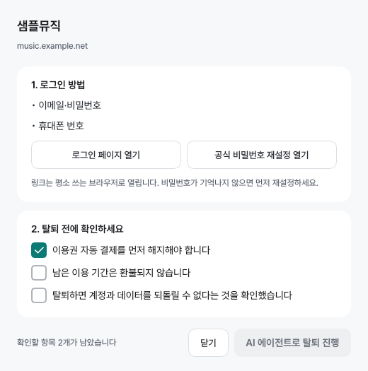
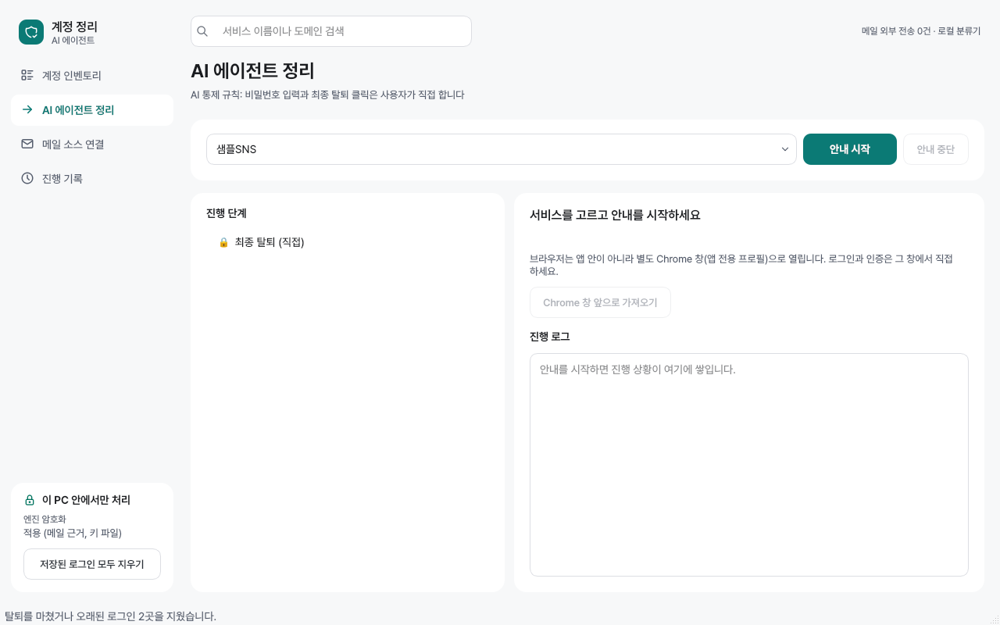
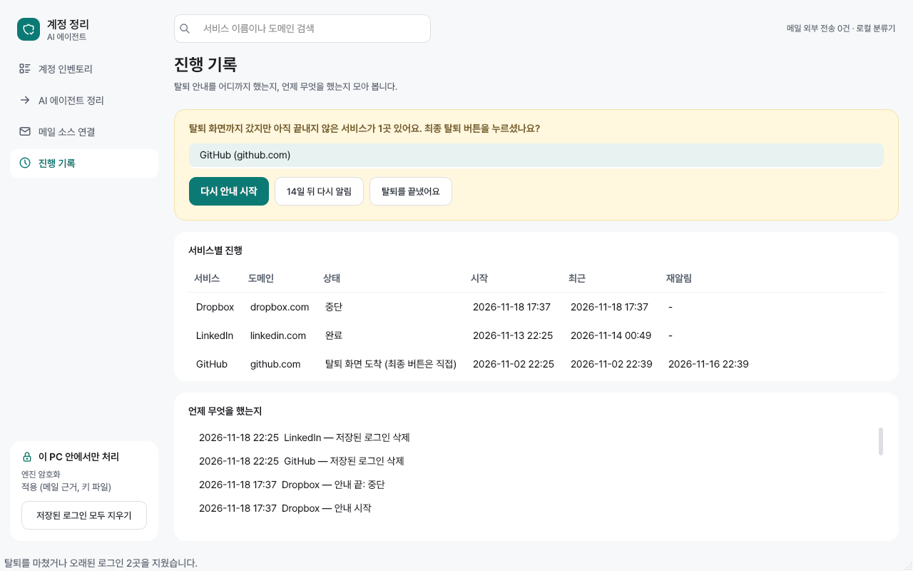

# 07. 범용 탈퇴 에이전트 — 인계 1-pager

> 받는 사람: 브라우저 에이전트 담당 · 작성: 2026-11-19 (흐름도·화면 추가) · 데스크톱 쪽 작업은 여기까지 끝났고, 남은 큰 일은 이 문서의 "범용 모드" 하나다.

## 1. 목표

**플레이북이 없는 처음 보는 사이트도** 탈퇴 화면까지 안내한다.
화면 전체(스크린샷·HTML)는 보내지 않는다. **링크·버튼 목록만 추려 LLM에 보내고**, LLM이 "다음엔 이걸 누르세요"라고 고르면 **코드가 규칙을 검사한 뒤** 클릭한다.
비밀번호 입력과 최종 탈퇴 버튼은 지금처럼 **사람이** 한다 (PRD "막혔을 때 (LLM 폴백)", ADR "플레이북 + 막힐 때만 LLM").

## 2. 지금 어디까지 됐나

| 기능 | 상태 | 볼 파일 |
|---|---|---|
| 플레이북 에이전트 (GitHub·Dropbox·LinkedIn) | ✅ GitHub·Dropbox는 실사이트에서 탈퇴 화면 도착 확인 (LinkedIn은 플레이북만) | `browser/withdraw_agent.py`, `browser/agent/engine.py`, `browser/playbooks/*.json` |
| Chrome 띄우고 붙기 (Google 로그인 차단 해결 #64) | ✅ | `browser/chrome_process.py` |
| 로그인·인증 화면 감지 → 사용자에게 넘김 | ✅ | `browser/agent/handoff.py` |
| 안전 규칙: 허용 도메인 밖 이동 차단, 최종 탈퇴 클릭 차단 | ✅ | `browser/agent/policy.py` |
| 마스킹: 이메일·카드번호·OTP → `[EMAIL]` 등 | ✅ (아직 LLM에 쓰는 곳 없음) | `browser/agent/redaction.py` |
| 화면 연결: 인벤토리 `탈퇴 준비하기` → 확인 창 → 에이전트, 에이전트 화면, 진행 기록 재알림 | ✅ | `ui/candidates/detail.py`, `ui/agent_page.py`, `main.py` |
| 데스크톱↔에이전트 계약 | ✅ | `contracts/agent.py` (`WithdrawAgent`, `AgentEvent`), `contracts/playbook.py` |
| **범용 모드 (LLM이 다음 클릭 고르기)** | ❌ **← 이번 일** | (새로 만듦) |

경로는 모두 `app/src/account_cleaner/` 아래.

## 3. 지금 어떻게 동작하나



## 3-1. 지금 화면

> 연습용 가짜 데이터로 찍은 화면이다 (`app/scripts/design_preview.py`). 범용 모드는 ②의 `탈퇴 준비하기`와 ③의 안내 흐름에 그대로 붙는다.

| ① 계정 인벤토리 — 후보 고르고 `탈퇴 준비하기` | ② 탈퇴 안내 창 — 로그인 방법 + 탈퇴 전 확인 |
|---|---|
|  |  |
| **③ AI 에이전트 정리 — 진행 단계·Chrome 상태·로그** | **④ 진행 기록 — 재알림·서비스별 진행** |
|  |  |

- 플레이북이 없는 서비스는 지금 ①의 `탈퇴 준비하기`가 꺼져 있다 (그림의 Dropbox가 그 상태). 범용 모드가 붙으면 여기가 켜진다.
- ③의 진행 로그에 LLM이 고른 이유(`reason`)를 한 줄씩 남기면 사용자가 왜 그 버튼을 눌렀는지 볼 수 있다.

## 4. 할 일: 범용 모드

### 4-1. 한 단계 루프 (최대 12단계)
1. `detect_handoff()` → 로그인·인증이면 **USER_TURN** (지금 코드 재사용)
2. 화면에 최종 탈퇴 버튼이 보이면(`policy.is_final_action`) → **REACHED**
3. 보이는 `a`, `button`, `[role=link|button]`을 최대 60개 추린다: `id`(번호), 글자(80자 자름), `aria-label`, 같은 사이트 `href` 경로
4. **마스킹**: `redact_sensitive()` + 사용자 메일 주소·이름 치환 (D-06), 입력칸 값은 절대 안 보냄
5. LLM 호출 → `{"choice": 번호 | null, "reason": "...", "found_withdraw_page": bool}`
6. 코드 검사: 번호가 목록에 있는지, `require_safe_click`(최종 버튼 아님), `href`가 허용 도메인인지, 이미 간 곳 반복이 아닌지 → 통과하면 클릭
7. `null`이거나 12단계 넘으면 **FAILED**: "탈퇴 메뉴를 찾지 못했어요. 고객센터에서 확인해 주세요."

### 4-2. LLM 호출 (Claude API, 구조화 출력)

```python
from pydantic import BaseModel
import anthropic

class NextClick(BaseModel):
    choice: int | None          # 누를 요소 번호, 없으면 None
    reason: str                 # 진행 로그에 보여 줄 한 줄
    found_withdraw_page: bool

client = anthropic.Anthropic()  # 키는 환경변수 / 사용자 설정. 배포본에 키를 넣지 않는다
response = client.messages.parse(
    model="claude-opus-5-5",
    max_tokens=1024,
    output_config={"effort": "low"},   # 한 단계는 짧은 선택 문제. 지연이 크면 claude-haiku-5-5와 비교 측정
    system="계정 탈퇴(회원 탈퇴·계정 삭제) 화면으로 가는 다음 요소 하나를 고른다. 최종 삭제 버튼은 고르지 않는다.",
    messages=[{"role": "user", "content": elements_json}],
    output_format=NextClick,
)
step = response.parsed_output
```
- `stop_reason == "refusal"`이면 FAILED로 처리.
- 시스템 프롬프트는 고정 → 프롬프트 캐싱으로 비용 절감.

### 4-3. 안전장치 (LLM이 아니라 코드가 강제)
- 허용 도메인 = 후보 도메인(+하위) + 소셜 로그인용 `auth_domains`(accounts.google.com 등, auth 도메인에선 조작 안 하고 사용자에게 넘김)
- 클릭만 한다. **글자 입력·파일 업로드·결제 버튼 금지**
- 최종 탈퇴 문구 클릭 차단 (`policy.py`) — LLM이 골라도 코드가 막음
- 진행 로그에 LLM이 고른 이유를 남겨 사용자가 볼 수 있게

### 4-4. 붙일 곳 (데스크톱 변경은 작게)
- **계약은 그대로**: 플레이북이 없는 후보는 `Playbook(id="generic:<domain>", domains=(domain,), steps=(), login_url=withdraw_url=f"https://{domain}", ...)`를 만들어 같은 `run()`으로 넘기고, `steps`가 비면 범용 루프를 탄다.
- 화면: `AgentPage.playbook_for_domain()`이 없으면 위 범용 플레이북을 돌려주게 → 상세 패널 버튼이 켜진다. 버튼 문구는 "AI 안내 (실험)"처럼 구분.
- 확인 창: 범용은 `pre_withdraw_conditions`가 비어 "탈퇴하면 되돌릴 수 없음" 체크 하나만 뜬다 (지금 코드 그대로 동작).

## 5. 완료 기준
- [ ] 플레이북 없는 실서비스 **3곳 중 2곳 이상** 탈퇴 화면 도착 (로그인은 사람이)
- [ ] 로컬 데모 사이트(`browser/agent/demo_server.py`)에 범용 모드 e2e 테스트
- [ ] LLM에 보낸 내용 로그에 이메일·이름 없음 (마스킹 테스트)
- [ ] 최종 탈퇴 버튼을 LLM이 골라도 차단되는 테스트
- [ ] API 키가 없으면 범용 버튼을 끄고 "API 키가 필요해요" 안내

## 6. 먼저 정할 것
| 항목 | 제안 |
|---|---|
| D-06 마스킹 | 정규식(`redact_sensitive`) + 사용자 메일 주소·표시 이름 문자열 치환. 80자 넘는 글은 자름 |
| API 키 | 개발은 `ANTHROPIC_API_KEY`. 배포본은 사용자가 설정에서 입력 (키체인 저장) — 팀 결정 필요 |
| 모델 | `claude-opus-5-5` + effort `low`로 시작, 단계당 지연·비용을 재고 필요하면 `claude-haiku-5-5`와 비교 |

## 7. 시작하기
```bash
cd app
uv run pytest tests/test_browser_*.py tests/test_chrome_process.py -q   # 지금 에이전트 테스트
uv run python -m account_cleaner.demo_mail --help                      # 로컬 데모 흐름
uv run python scripts/design_preview.py                                # 가짜 데이터로 앱 띄우기
```
참고: [PRD](01_PRD_계정정리_AI_에이전트.md) "막혔을 때 (LLM 폴백)" · [ADR](02_ADR_기술스택.md) 브라우저 에이전트 · [논의사항 D-06](03_논의사항.md) · [04. 브라우저 에이전트](04_브라우저에이전트.md)
